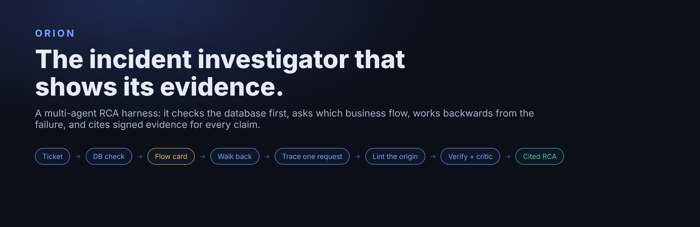
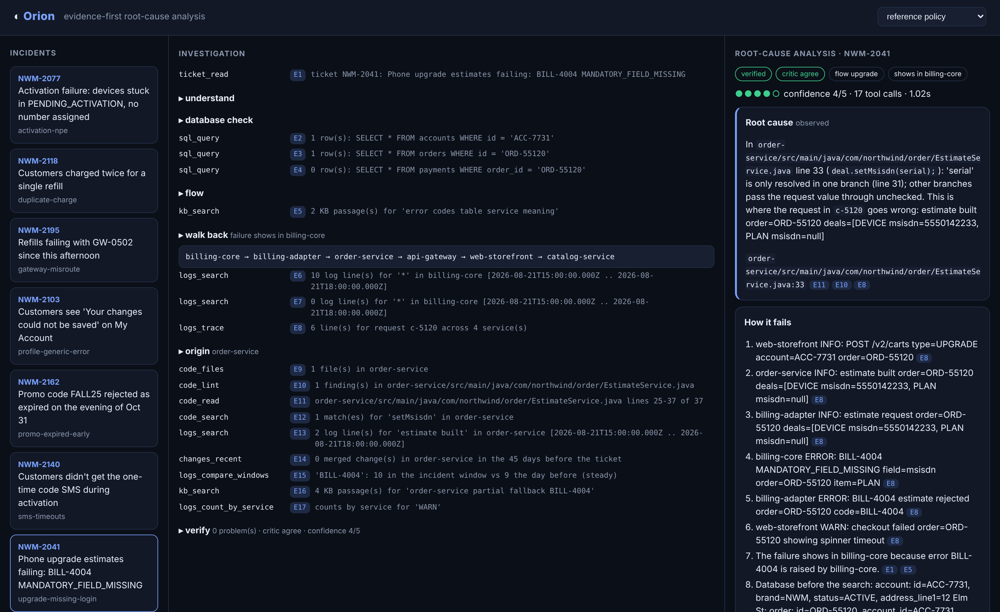
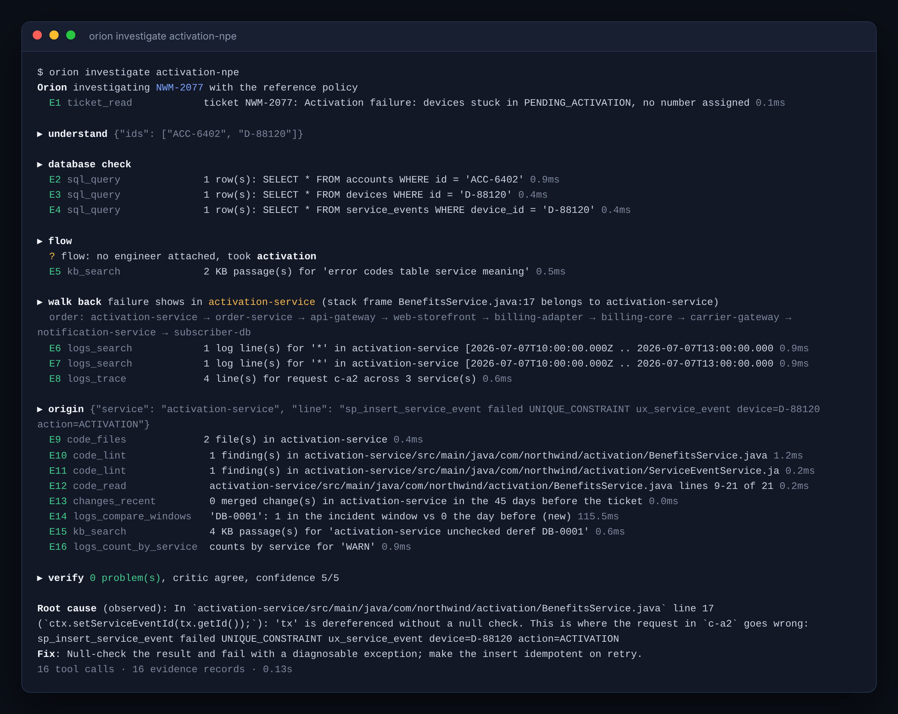
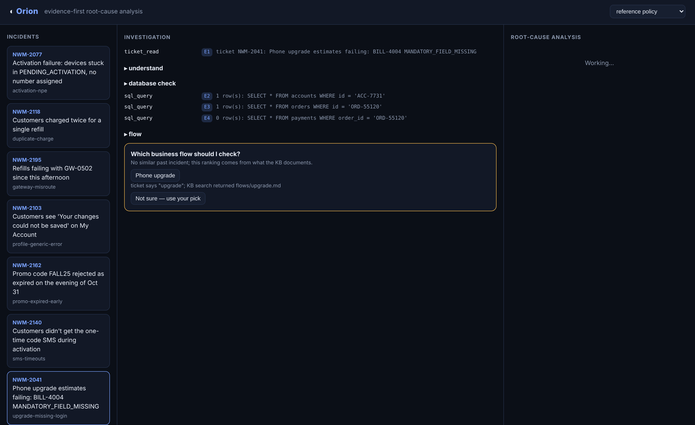
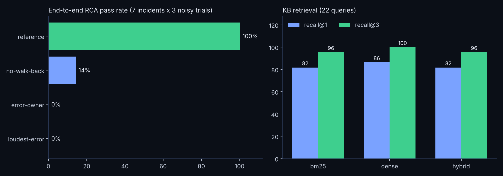
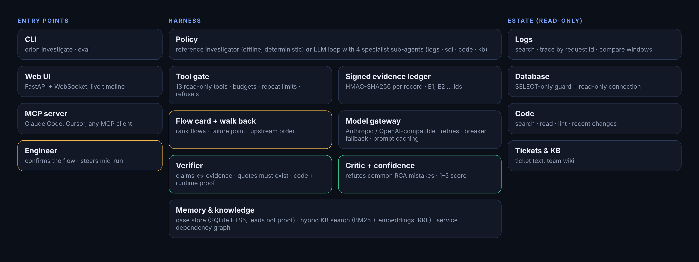

<p align="center"></p>

<p align="center">
<b>Give Orion a production ticket. It reads the logs, the database and the code, finds where the failure actually starts,<br>
and hands back a root-cause analysis where every sentence points to signed evidence.</b>
</p>

<p align="center">
<a href="#start-in-a-minute">Quickstart</a> ·
<a href="#how-it-investigates">How it works</a> ·
<a href="#measured-not-claimed">Evals</a> ·
<a href="#the-harness">Harness</a> ·
<a href="#for-your-agents">MCP</a> ·
<a href="docs/architecture.md">Architecture</a> ·
<a href="docs/sample-rca.md">Sample RCA</a>
</p>

<p align="center">
<a href="https://github.com/dev-null-k2/orion-rca/actions/workflows/ci.yml"></a>


</p>

---

<p align="center"></p>

## Why it exists

On-call engineers spend hours on one ticket: open Kibana, guess a query, read a stack trace, `grep` four repos,
ask the DBA for a row, and finally write an RCA nobody can check. Generic AI chat makes it worse in a new way:
it sounds certain and cites nothing.

Orion is built from what actually works when you investigate a real estate by hand:

- **Look at the customer's records first.** Half the answers are in the database before you touch a log.
- **Know which business flow you are in.** "Activation" and "refill" fail in different places.
- **Start where the failure shows, then walk backwards.** The system that *reports* an error (billing, the database)
  usually isn't the one that *caused* it.
- **Follow one failing request.** The loudest error in the logs is almost never the cause.
- **Prove every claim.** If a sentence can't point at a log line, a row or a line of code, it doesn't ship.

Orion turns those habits into an agent harness, then measures whether they help.

## What's new here

| | |
|---|---|
| **Works backwards, on purpose** | A service dependency graph and a *failure point* decide the order: the failing system, its adapters, their callers. No "search everything". |
| **Every claim is checkable** | Tool results land in an HMAC-signed evidence ledger (`E1`, `E2`, …). The verifier rejects any claim that cites a missing or tampered record, or quotes a value its evidence doesn't contain. |
| **A critic that argues back** | Before an answer ships, a critic checks for the classic RCA mistakes: blaming the system of record, blaming the loudest service, no baseline, no request traced end to end. |
| **Human in the loop where it matters** | Orion asks the engineer which business flow to check (with its reasons), takes steering mid-run, and never writes anywhere. |
| **Runs with or without an LLM** | A deterministic reference investigator runs the whole method offline (that's what CI evals). Swap in Claude, GPT, Gemini or a local model through the same tools, ledger and verifier. |
| **Measured, not claimed** | Seven synthetic production incidents with ground truth, three noisy trials each, four policies compared, plus retrieval and flow-routing evals. A release gate fails the build if quality drops. |

## How it investigates

<p align="center"></p>

1. **Read the ticket.** Pull out accounts, orders, devices, phone numbers, error codes and stack frames.
2. **Database first.** Read-only SELECTs for every identifier, before any log search.
3. **Pick the business flow.** Past incidents first, then the knowledge base. Orion says which of three cases it is in
   (a similar past incident / no past incident, ranked from the KB / the KB knows little, so this may be new) and asks the engineer to confirm.
4. **Find the failure point and walk back.** `BILL-4004` is raised by billing, so start at billing, then the billing adapter,
   then whoever built the request. Front-end failures walk forward from the page.
5. **Anchor on one failing request** that matches the ticket's identifiers, then **trace its request id** across every service.
6. **The earliest anomaly in that request is where it starts.** Read and lint that service's code; keep only findings that
   explain the runtime symptom (`msisdn=null` → a field resolved in one branch only).
7. **Context.** A comparable request that worked, recent merged changes, and the error rate against the day before.
8. **Verify, critique, score.** Claims must cite code *and* runtime evidence. The critic objects or agrees. Confidence 1-5.

<details>
<summary><b>See the flow question in the web UI</b></summary>
<p align="center"></p>
</details>

## Measured, not claimed

`orion eval` runs everything below in about 30 seconds on a laptop, with no network. Raw numbers:
[`results/eval-report.json`](results/eval-report.json).

<p align="center"></p>

**End-to-end RCA**: 7 incidents x 3 trials, each trial with a different seed and a louder background of decoy errors.
A trial passes when the root-cause service *and* file are right, at least 75% of the key facts appear, and no forbidden claim is made.

| Policy | What it does | pass@1 | pass^3 | Root file | Fact recall | Median tool calls |
|---|---|---|---|---|---|---|
| **reference** | Orion's method | **100%** | **100%** | **100%** | 89% | 17 |
| no-walk-back | same tools, searches every service, no request tracing | 14% | 14% | 43% | 40% | 25 |
| error-owner | blames whoever logs the ticket's error code | 0% | 0% | 57% | 31% | 6 |
| loudest-error | blames the noisiest service | 0% | 0% | 0% | 0% | 5 |

| Other checks | Result | How |
|---|---|---|
| Confidence separates right from wrong | 4.6 / 5 when right, 1.8-2.9 when wrong | `mean_confidence_when_*` in the report |
| Forbidden claims (reference) | 0 of 21 trials | phrases that would blame the wrong system |
| Verification rate (reference) | 100% | every claim cites existing, untampered evidence |
| KB retrieval, 22 questions | recall@3: BM25 96%, dense 100%, hybrid 96% | [`evals/sets/retrieval.yaml`](orion/evals/sets/retrieval.yaml) |
| Flow routing, 24 messy tickets | top-1 83%, top-3 100%; asks the engineer on 21% | [`evals/sets/flows.yaml`](orion/evals/sets/flows.yaml) |
| Unit and end-to-end tests | 38 passing | `pytest` |

**Read these numbers honestly.**
- The seven incidents were written alongside the reference policy, so 100% is a regression bar, not proof it generalises.
  The ablations are the interesting part: the same tools without walk-back and tracing drop to 14%.
- "Verified" means *grounded*, not *correct*: the no-walk-back ablation is 100% verified and mostly wrong. That's why the critic and the confidence score exist.
- On a KB this small, plain dense retrieval beats the hybrid. Hybrid stays the default because BM25 is what finds exact error codes on real, larger wikis.
- The LLM policy is wired, unit-tested with a scripted model, and runs with your key (`--policy llm`), but its scores are not in this table yet.

## The harness

The policy (reference or LLM) never touches a system. Everything goes through one gate.

<p align="center"></p>

| Piece | What it does | Code |
|---|---|---|
| Tool gate | 13 read-only tools with JSON schemas; budgets for tool calls, time and tokens; a repeat limit per identical call; refusals are events, not crashes | [`harness.py`](orion/harness.py), [`tools.py`](orion/tools.py) |
| Evidence ledger | Every result becomes `E<n>` with an HMAC-SHA256 signature; tampering is detected on read | [`harness.py`](orion/harness.py) |
| Guards | SELECT/WITH only, one statement, no admin keywords, *and* a read-only SQLite connection; file reads can't leave the repos | [`tools.py`](orion/tools.py) |
| Flow catalog + walk | Business flows, failure points, the service call graph; ranks flows in three explicit cases; orders services upstream from the failure | [`flows.py`](orion/flows.py), [`flows.yaml`](orion/estate/flows.yaml) |
| Hybrid retrieval | Markdown chunking on headings, BM25, dense vectors (bge-small if installed, a hashed n-gram embedder offline), reciprocal rank fusion | [`retrieval.py`](orion/retrieval.py) |
| Static checks | Lint rules for incident-shaped defects: null on failure, unchecked dereference, swallowed exceptions, non-idempotent retries, timeout budgets, naive timezones, unknown upstreams, one-branch fallbacks | [`lint.py`](orion/lint.py) |
| Verifier, critic, confidence | Claims ↔ evidence, quotes must exist, root cause needs code + runtime proof; critic objections; 1-5 score | [`verify.py`](orion/verify.py) |
| Memory | Resolved RCAs in SQLite FTS5, recalled as *leads* for similar tickets, never as proof | [`memory.py`](orion/memory.py) |
| LLM loop | Tool calling, 4 specialist sub-agents (logs, sql, code, kb), context compaction at 80% of the window, engineer steering, one send-back on failed verification | [`policies/llm.py`](orion/policies/llm.py) |
| Model gateway | Anthropic Messages API and any OpenAI-compatible endpoint; retries with backoff and `Retry-After`; circuit breaker; model fallback; prompt caching; token accounting | [`models.py`](orion/models.py) |

## Use cases

- **L2/L3 production support**: first-pass RCA on a ticket in minutes, with the evidence an SRE can check in one click.
- **Incident review**: a structured "how it fails" chain and a "ruled out" list for the postmortem.
- **Onboarding**: new engineers watch how a ticket is traced through the estate, step by step.
- **Agent builders**: a compact, tested reference for harness design (tool gates, evidence ledgers, verification, critics, evals with ablations).
- **Evaluating models on RCA**: plug a model in with `--policy llm` and score it against the same incidents and baselines.

## Start in a minute

```bash
git clone https://github.com/dev-null-k2/orion-rca && cd orion-rca
python -m venv .venv && source .venv/bin/activate
pip install -e ".[dev]"

orion scenarios                                  # 7 incidents in a fictional mobile carrier, "Northwind Mobile"
orion investigate upgrade-missing-login          # watch it work, offline
orion investigate duplicate-charge --interactive # you answer the flow question
orion investigate sms-timeouts --out rca.md      # Markdown RCA with an evidence table
orion eval                                       # evals + release gate (exit code 1 if the gate fails)
orion serve                                      # web UI on http://127.0.0.1:8123
```

Use a real model:

```bash
export ANTHROPIC_API_KEY=...            # or ORION_PROVIDER=openai OPENAI_API_KEY=... [OPENAI_BASE_URL=...]
export ORION_MODELS=claude-sonnet-4-5   # comma-separated: fallbacks in order
orion investigate activation-npe --policy llm
```

## For your agents

Orion speaks MCP over stdio, so Claude Code, Cursor or any MCP client can call it.

```bash
claude mcp add orion -- orion mcp
```

Tools: `orion_list_incidents`, `orion_investigate` (returns the full Markdown RCA with its evidence table).

## Project layout

```
orion/
  harness.py         tool gate, signed ledger, budgets, events, human-in-the-loop
  tools.py           13 read-only tools + guards
  flows.py           flow ranking, failure point, walk-back order
  retrieval.py       BM25 + dense + RRF over the KB
  lint.py            incident-shaped static checks
  verify.py          verifier, critic, confidence
  memory.py          case store (FTS5)
  models.py          model gateway (Anthropic, OpenAI-compatible)
  policies/          reference investigator, LLM investigator, baselines
  evals/             RCA, retrieval and flow evals, release gate
  estate/            the synthetic estate: flows, KB, repos with seeded defects, 7 incident scenarios
  server.py, cli.py, mcp.py
tests/               38 tests: guards, ledger, retrieval, flows, verifier, LLM loop, MCP, end to end
docs/                architecture, harness, evals, adding a connector, security, sample RCA
```

## Where it goes next

See [ROADMAP.md](ROADMAP.md). Next up: LLM policy scores in the eval table (3 trials per model), connectors for
OpenSearch, Postgres and GitHub behind the same tool gate, a world-model that stores the service hops Orion observes,
and harder held-out incidents written by someone other than the author.

## The story

I built the first Orion at work as the RCA assistant for a large telecom's production-support engineers: local-first,
human-in-the-loop, wired into the real logs, databases, code and tickets. That code and its knowledge base belong to
the client, so they are not here.

**This repository is a clean-room rewrite**: the same method and harness ideas, written from scratch on an invented
estate. Every service, ticket, log line, table and line of code in it is synthetic.

Built by **Karthik Kasukurti**. Contributions welcome: see [CONTRIBUTING.md](CONTRIBUTING.md). Licensed under [Apache-2.0](LICENSE).
