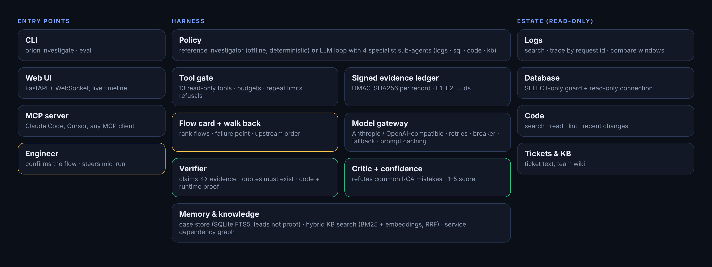
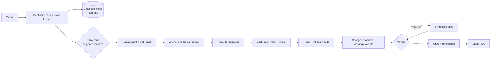

# Architecture

## Processes

Everything runs in one Python process. Entry points are the CLI (`orion`), the web server (`orion serve`,
FastAPI + one WebSocket per investigation) and an MCP stdio server (`orion mcp`). Each investigation gets its own
`Harness`, ledger and budget, so runs never share state except the case memory.

## Data flow of one run

1. `runner.investigate` builds (or receives) an `Estate`: logs, a SQLite file opened read-only, repos, KB, changes, ticket.
2. The policy calls tools only through `Harness.call`. Every call emits `tool_start`/`tool_end` events, which the CLI
   prints and the web UI streams.
3. Results become signed `Evidence` records with ids.
4. The policy returns an `Answer` (pydantic). `verify.finalize` checks it, runs the critic and sets confidence.
5. A verified answer is stored in case memory as a lead for future tickets.

## The estate abstraction

The demo estate is synthetic, but the tool interfaces mirror real systems: an ELK-style log search with request-id
tracing, a SQL database, git repos with a change log, a ticket, and a Markdown wiki. Pointing Orion at a real estate means
implementing the same tool functions against real clients; see [adding-a-connector.md](adding-a-connector.md).
